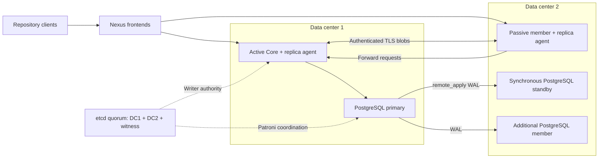
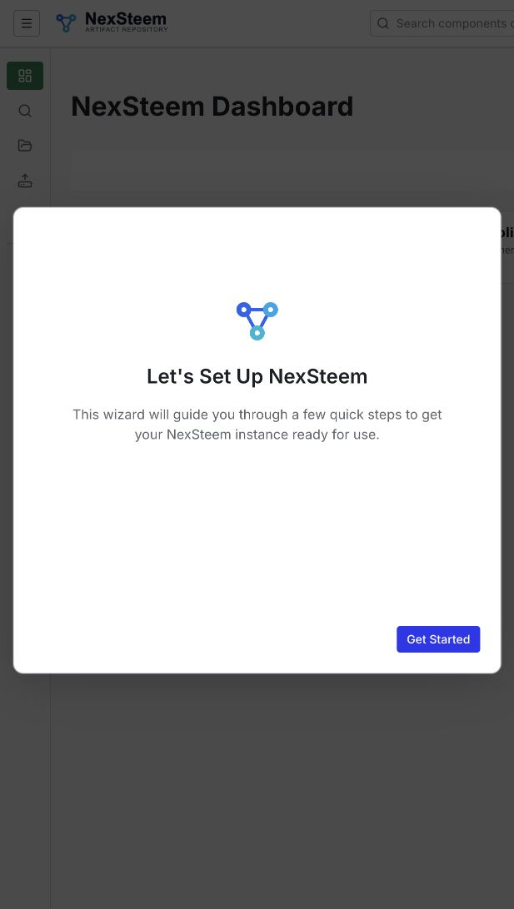
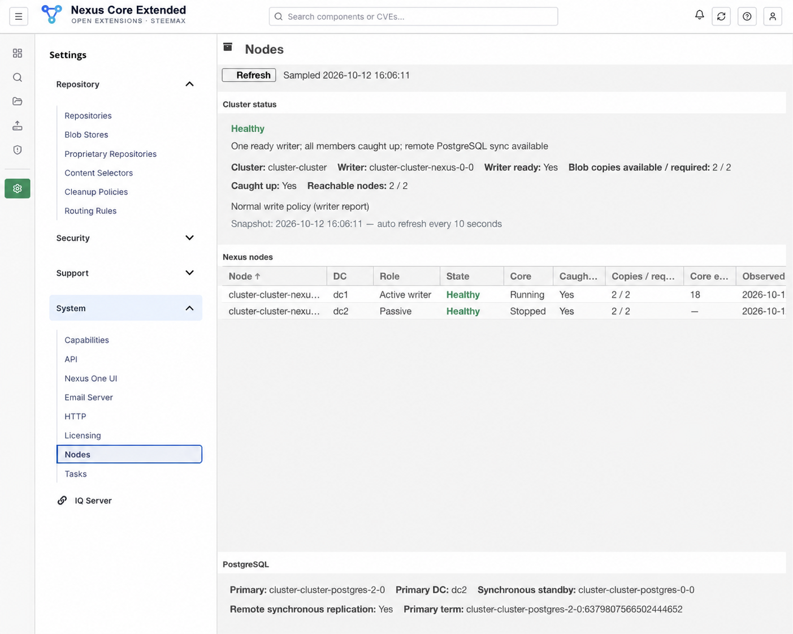

<p align="center">
  
</p>

# NexSteem

An independently maintained, source-built artifact repository by **steemax**, based on Sonatype Nexus Repository Core. NexSteem adds repository formats, Keycloak single sign-on, and an optional Kubernetes deployment with built-in data replication and automatic failover. Source repository: [steemax/nexsteem](https://github.com/steemax/nexsteem); Docker Hub image repository: `steemax/nexsteem`. The application name is **NexSteem**; upstream component names and attribution remain intact.

This project is independent of Sonatype. It is not an official Community Edition or Pro distribution, and does not claim feature parity with either product. Builds use the public Core sources and the extensions in this repository, without the Community Edition or Pro server binaries.

**Current foundation:** Core `3.96.4-01`, Java 25, Linux `amd64`. The upstream Git submodule is pinned to commit `e60cdf28e5808a25c2524edb8b1550a0c7f08d82` in [upstream.lock.json](upstream.lock.json).

## Features

- **22 repository formats, 51 recipes** across hosted, proxy, and group modes. See the [format matrix](docs/formats.md) for the types supported by each format.
- **Docker Registry V2 and OCI:** hosted, proxy, and group repositories, Docker connector ports, and Helm OCI artifacts. **Helm chart repositories:** hosted and proxy.
- **Keycloak through OAuth 2.0 / OpenID Connect:** browser login with Authorization Code and PKCE S256, validated JWT access tokens, logout, and explicit mapping to Nexus roles. LDAP remains a separate authentication option.
- **Kubernetes active/passive Core:** automatic writer election, SQL and blob fencing, encrypted peer replication, and automatic catch-up after a member or data center returns.
- **Cluster visibility:** `System → Nodes` shows the active writer, passive members, replication copies, degraded state, and PostgreSQL status.
- **Deployment choices:** standalone Docker, or the separate Kubernetes cluster image and Helm chart for built-in replication.
- **Upstream maintenance:** a pinned, unmodified upstream checkout, separate extensions, build provenance, and an ordered cluster upgrade coordinator.

Supported formats: APT, Cargo, CocoaPods, Composer, Conan, Conda, Docker, Git LFS, Go, Helm, Hugging Face, Maven, npm, NuGet, P2, PyPI, R, Raw, RubyGems, Swift, Terraform, and Yum.

## Clone the source repository

To build NexSteem from source or work on the Core integration, clone the repository with its pinned upstream submodule:

```bash
git clone --recurse-submodules https://github.com/steemax/nexsteem.git
```

This also fetches the public Core sources into `upstream/nexus-public`. If you already cloned without submodules, run the following from your checkout's root:

```bash
git submodule update --init --recursive
```

GitHub's automatically generated source ZIP does not include the Core submodule contents. Use the recursive clone or the complete corresponding-source archive for a source build. See [Build from source](docs/INSTALL.md#build-from-source) for build commands and prerequisites.

Deploying prebuilt Docker images or installing the Helm chart does not require downloading the Core submodule; the deployment examples below use a plain clone where only Compose or chart files are needed.

## Choose a deployment

| Deployment | Use it for | Components |
|---|---|---|
| Standalone Docker / Compose | A single NexSteem instance or local evaluation | `steemax/nexsteem:3.96.4-01-standalone-ext3`; persistent data volume |
| Kubernetes HA | Replication and automatic failover between two data centers | `steemax/nexsteem:3.96.4-01-cluster-k8s10`; PostgreSQL/Patroni, etcd and Helm |

**A single instance is supported by the standalone image and Docker/Compose.** It runs one Core process with its own persistent data volume and does not require the cluster PostgreSQL/Patroni, etcd or replication services. Repository formats and Keycloak/OIDC remain available; cluster replication, automatic failover and the cluster Nodes dashboard belong to the HA distribution.

**The `nexsteem` Helm chart is HA-only.** It requires at least two Nexus members, three PostgreSQL members and three etcd members; only one Nexus Core writer runs at a time. Setting `nexus.replicas: 1` does not enable standalone mode and is rejected. This public distribution currently includes no standalone Kubernetes Helm chart. Do not use the standalone image as a replacement for the cluster image in the HA chart.

**Built-in replication and automatic failover are provided only by the Kubernetes cluster distribution.** The standalone Docker image does not include that layer. The matching PostgreSQL/Patroni image is `steemax/nexsteem:postgres-17-patroni4.1.5-r3-amd64`. All three project images use one Docker Hub repository, with separate component tags.

**Release status:** standalone ext3, cluster k8s10 and PostgreSQL r3 have been built with verified notices and corresponding-source links. Standalone UI/login/onboarding and all 51 recipe registrations were verified. The exact cluster boot and ordered upgrade passed with both members ready, matching provenance, remote PostgreSQL sync and two blob copies. The full artifact-client and fault matrix was not rerun for this UI/legal rebuild. The GitHub Pages Helm repository is online, and chart `0.1.5` was downloaded and its checksum verified. Docker Hub image and GitHub binary-release publication remain separate steps; ensure the selected images are accessible before deployment. See [INSTALL](docs/INSTALL.md) for exact image identities and build options.

The designated source release is [3.96.4-01-ext3-k8s10](https://github.com/steemax/nexsteem/releases/tag/3.96.4-01-ext3-k8s10), with complete archive [nexsteem-3.96.4-01-ext3-k8s10-source.tar.gz](https://github.com/steemax/nexsteem/releases/download/3.96.4-01-ext3-k8s10/nexsteem-3.96.4-01-ext3-k8s10-source.tar.gz). These are planned publication links, not existing downloads.

The older `ext2` / `k8s9` images remain **historical references** with their original branding and sources. They are preserved separately and are not substitutes for the newly rebuilt NexSteem images. See [branding](branding/README.md).

### Standalone Docker / Compose

After the new standalone image is accepted and published:

```sh
git clone https://github.com/steemax/nexsteem.git
export NEXUS_IMAGE=steemax/nexsteem:3.96.4-01-standalone-ext3
docker pull --platform linux/amd64 "$NEXUS_IMAGE"
docker compose -f ./nexsteem/deploy/compose.yaml up -d
```

Open `http://localhost:8081`. Retrieve the initial `admin` password after startup:

```sh
docker compose -f ./nexsteem/deploy/compose.yaml exec nexus cat /var/lib/nexus/admin.password
```

Compose `down` retains the data volume. To build instead of downloading, use [the source installation instructions](docs/INSTALL.md#build-from-source).

### Kubernetes quick start

This section installs the HA profile. For one standalone instance, use [Docker/Compose](#standalone-docker--compose); the chart has no single-instance switch.

This example selects NexSteem **k8s10**, PostgreSQL **r3** and chart **0.1.5**. Boot and ordered-upgrade acceptance passed; publication remains pending. The existing Nodes screenshot remains a separately labelled preview.

Use one geo-distributed Kubernetes cluster. Label **three data workers and an independent witness worker** to match their actual locations:

```sh
kubectl label node YOUR_DC1_WORKER nexus.cluster/dc=dc1
kubectl label node YOUR_DC2_WORKER_A nexus.cluster/dc=dc2
kubectl label node YOUR_DC2_WORKER_B nexus.cluster/dc=dc2
kubectl label node YOUR_WITNESS_WORKER nexus.cluster/dc=witness
```

Confirm the intended kubectl context first. The control plane, DNS, ingress and storage must also survive the intended data center loss. Create `production-values.yaml`, replacing the StorageClass, PVC capacities, ingress and DNS settings for your cluster:

```yaml
clusterDomain: cluster.local
nexus:
  image: steemax/nexsteem:3.96.4-01-cluster-k8s10
  replicas: 2
  nodes:
    - {dc: dc1, nodeSelector: {nexus.cluster/dc: dc1}}
    - {dc: dc2, nodeSelector: {nexus.cluster/dc: dc2}}
  storageClass: YOUR_DURABLE_STORAGE_CLASS
  storageSize: 100Gi
  resources:
    requests: {cpu: "1", memory: 2Gi}
    limits: {cpu: "4", memory: 4Gi}
postgres:
  image: steemax/nexsteem:postgres-17-patroni4.1.5-r3-amd64
  storageClass: YOUR_DURABLE_STORAGE_CLASS
  storageSize: 20Gi
  resources:
    requests: {cpu: 250m, memory: 512Mi}
    limits: {cpu: "2", memory: 1Gi}
etcd:
  storageClass: YOUR_DURABLE_STORAGE_CLASS
  storageSize: 2Gi
  resources:
    requests: {cpu: 100m, memory: 128Mi}
    limits: {cpu: "1", memory: 512Mi}
router:
  resources:
    requests: {cpu: 50m, memory: 32Mi}
    limits: {cpu: 500m, memory: 128Mi}
networkPolicy:
  clientNamespaceSelector:
    matchLabels: {kubernetes.io/metadata.name: ingress-nginx}
ingress:
  enabled: true
  className: nginx
  hostname: nexus.example.org
  tlsSecret: nexus-public-tls
```

`storageSize` is the requested capacity of each member's PVC, not a cluster-wide total. These values match the chart defaults: two Nexus members request `2 × 100Gi`, three PostgreSQL members `3 × 20Gi`, and three etcd members `3 × 2Gi`. Size each Nexus PVC for the complete artifact dataset and operational headroom; the replicated copies do not combine into one larger store.

`resources.requests` and `resources.limits` apply to each container of the selected component, not to the cluster total. Set them under `nexus`, `postgres`, `etcd` and `router`; the full [chart resource reference](deploy/helm/nexsteem/README.md#resource-budgets) also covers the Nexus init container and both Jobs. Coordinate Nexus memory limits with `nexus.javaOpts`: the budget includes Core heap, direct/native memory and the cluster supervisor.

If the witness is a tainted control-plane node, add a matching `tolerations` entry; see the full example values. If the Docker Hub repository is private, configure `imagePullSecrets`.

The chart defaults place PostgreSQL on three separate data hosts and etcd across `dc1`, `dc2` and `witness`. This override runs two Nexus members, one per data center. Keep production anti-affinity enabled. Create the client-facing TLS Secret in namespace `nexus` and adapt the ingress namespace selector for your controller.

Use the online GitHub Pages Helm repository after ensuring the selected images are available to your Kubernetes workers:

```sh
helm repo add nexsteem https://steemax.github.io/nexsteem/charts
helm repo update
helm upgrade --install nexus nexsteem/nexsteem --version 0.1.5 \
  --namespace nexus --create-namespace \
  --values production-values.yaml --wait --timeout 15m
```

You can also install the chart directly from a Git checkout:

```sh
git clone https://github.com/steemax/nexsteem.git
helm upgrade --install nexus ./nexsteem/deploy/helm/nexsteem \
  --namespace nexus --create-namespace \
  --values production-values.yaml --wait --timeout 15m
```

Skip the clone if it already exists. Chart-only installation does **not** require fetching the Core submodule or compiling Java. A release's `nexsteem-0.1.5.tgz` is another installation option. Keep the existing Helm release name and namespace: the chart name changes neither the retained resource prefix nor PVC ownership. See [INSTALL](docs/INSTALL.md#kubernetes-with-built-in-replication) for checks and full configuration.

## How Kubernetes replication works

The cluster profile runs in **one Kubernetes cluster** spanning two data centers and an independent coordination witness. Each Nexus member has its own PVC. A supervisor and replica agent run on every member; only the current writer starts the Core JVM, migrations, and scheduled tasks. Passive frontends forward client requests to that writer.

Artifact bytes are replicated by the `ClusterLocal` blob store over authenticated TLS. PostgreSQL stores repository metadata and the committed blob journal. In normal mode, a successful write requires two durable blob copies, including the other data center, and an actual PostgreSQL synchronous replica in that data center using `remote_apply`.



*Logical normal-mode example. Active Core and PostgreSQL roles can move during failover; the witness does not store artifact bytes.*

Writer ownership is tied to a fixed process owner, epoch, and PostgreSQL primary term. SQL statement, transaction, and DDL guards, durable replica fences, and fresh etcd/primary checks before successful HTTP responses prevent a stale managed Core from acknowledging writes. A lease timer alone does not grant ownership.

With degraded writes enabled, loss of the remote data center permits local writes after authority is established. Status reports the reduced copy count. Returning members automatically catch up; normal mode resumes after the required remote copies and PostgreSQL synchronization are restored. A further loss before catch-up can lose newly written data from that degraded period. Replication also propagates deletions, so it does not replace backups.

The witness stores coordination data, not artifact copies. Kubernetes control plane, DNS, ingress, storage, and network placement must also survive the intended data center failure. This chart does not federate two independent Kubernetes clusters or provide a physical power-fencing system.

See [INSTALL](docs/INSTALL.md#kubernetes-with-built-in-replication), [UPGRADING](docs/UPGRADING.md#upgrade-a-running-kubernetes-cluster), and the [cluster chart reference](deploy/helm/nexsteem/README.md).

## NexSteem setup



*Actual setup wizard from the final standalone ext3 image, with the NexSteem name and header mark. This is a runtime capture, not an edited branding preview.*

## System → Nodes



*Branding preview based on the tested k8s9 Nodes dashboard; the header logo was replaced for presentation.*

The cluster-only dashboard refreshes every ten seconds and supports manual refresh. It distinguishes healthy, degraded, unavailable, and unknown observations. A passive member with a stopped Core is expected; missing monitoring observations are not presented as proof of lost write durability. Access is controlled by Nexus permissions.

## Authentication and repository clients

Configure Keycloak in `Security → OAuth 2.0`, using a confidential client, Standard Flow, PKCE S256, the intended token audience, and redirect URI `<public Nexus URL>/oidc/callback`. Map identity-provider roles explicitly to existing Nexus role IDs, then activate `OAuth2Realm`. Use HTTPS and configure the public Nexus URL to match your ingress. LDAP configuration does not configure Keycloak.

Repository clients keep their native authentication flows. Docker uses registry login, while NuGet and RubyGems expose their own API-key flows; a browser OIDC session is not a universal package-client credential. See [architecture](docs/architecture.md) for the authentication implementation.

For Docker on the main Nexus hostname, tags include the repository name, for example `nexus.example.org/docker-hosted/my-app:1.0`. A dedicated Docker connector selects the repository by its port. See [INSTALL](docs/INSTALL.md#docker-and-helm-endpoints) for endpoint setup.

## Updates and validation

Core sources stay in `upstream/nexus-public`; extensions stay in `extensions/`. Builds integrate them into a disposable copy under `build/source`. Upstream updates change both the submodule pointer and lock file and require compatibility testing. Running Kubernetes clusters use an ordered passive-first upgrade and a SQL release gate; plain Helm rollout or rollback is insufficient for database migrations.

See [UPGRADING](docs/UPGRADING.md) for upstream changes, application and infrastructure upgrades, schema hooks, and backup requirements.

Core and all repository-format modules were compiled from source: 115 Core Maven modules were rebuilt, followed by two UI Maven modules after the wizard repair. The Core build skips its test suite; twelve Python unit tests passed. Standalone UI/login/onboarding, all 51 recipe registrations, and exact cluster boot/ordered-upgrade readiness with two copies and remote PostgreSQL sync were verified. The full artifact-client and fault matrix was not rerun for this UI/legal rebuild; historical results remain attributed to their tested revisions. Pinned OS/JDK/PG layers were reused, and bit-for-bit reproducibility is not established. See [verification](docs/verification.md) for scope.

## Licenses and attribution

Core and project EPL contributions are distributed under [EPL-1.0](LICENSE.txt). Imported components retain their own licenses and attributions; see [NOTICE](NOTICE.txt), [THIRD-PARTY-NOTICES](THIRD-PARTY-NOTICES.md), `licenses/`, and module source-origin records. Upstream Sencha Ext JS license notices are preserved. The applicability of the historical Sonatype/Sencha FLOSS exception to NexSteem has not been established; retaining notices does not resolve that question or grant another exception.

To prepare repository metadata and releases, see [.github/REPOSITORY-SETUP.md](.github/REPOSITORY-SETUP.md).
